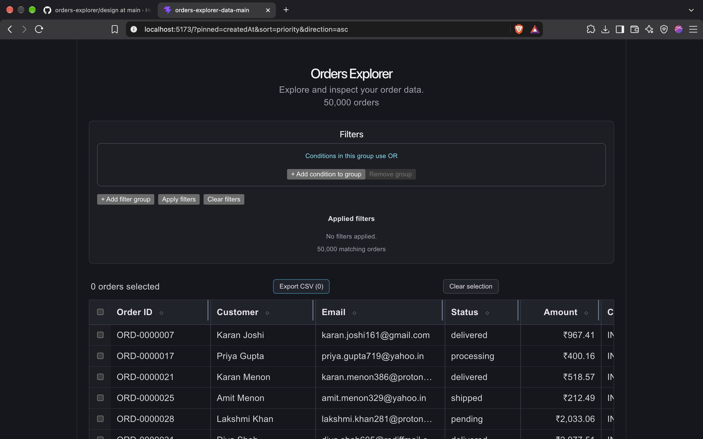
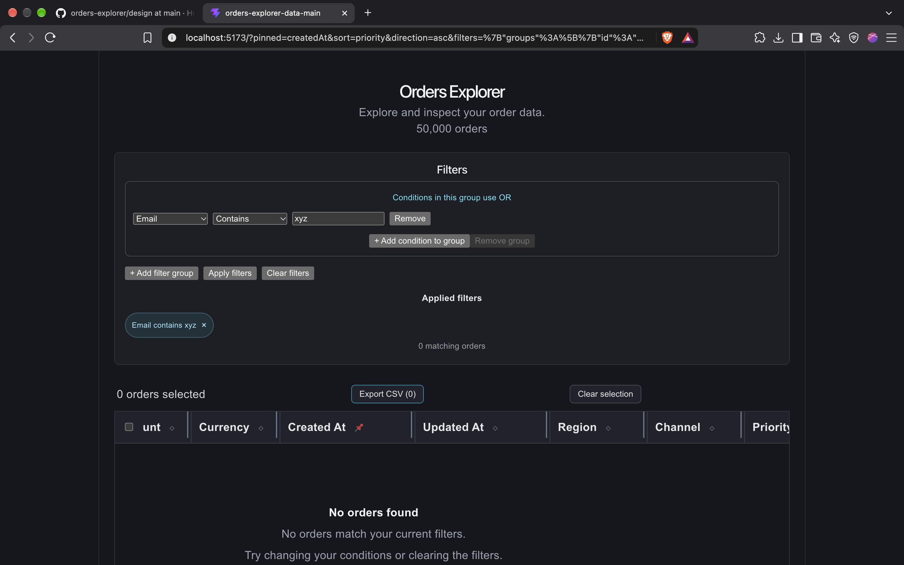

# Orders Explorer

A React and TypeScript application for exploring, filtering, sorting, and exporting approximately 50,000 order records. It features a custom virtualized data grid, a flexible filter builder, keyboard navigation, URL-persisted state, and CSV export.

## Features

- **Large dataset:** Loads and normalizes order records from a JSON dataset.
- **Virtualized grid:** Renders a window of visible rows to reduce DOM overhead when working with large datasets.
- **Sorting:** Sorts columns using their underlying data types, with missing `updatedAt` values kept at the bottom.
- **Column resizing:** Adjusts column widths to make information easier to inspect.
- **Column pinning:** Pins a column while scrolling horizontally.
- **Row selection:** Supports individual selection, Shift-click range selection, and selection of visible results using the header checkbox.
- **Keyboard navigation:** Uses arrow keys to navigate cells, Enter to open order details, and Space to toggle row selection.
- **Filter builder:** Supports text, numeric, date, and fixed-choice conditions.
- **Filter logic:** Conditions within a group use OR; separate groups use AND.
- **URL persistence:** Stores filters, sorting, pinned-column state, and selected order IDs in the URL so supported state can be restored or shared.
- **Invalid URL handling:** Falls back to default filter state and displays a warning for invalid filter parameters.
- **CSV export:** Exports selected orders, including orders hidden by active filters.
- **Order details:** Provides access to full field values, including long notes.
- **Empty state:** Displays a helpful message when no orders match the current filters.

## Tech Stack

- React
- TypeScript
- Vite
- JSON
- Custom row virtualization
- Custom filter builder
- CSS

## Requirements

- Node.js 24
- npm

## Getting Started

Clone the repository and enter the project directory:

```bash
git clone https://github.com/Hunterx15/orders-explorer.git
cd orders-explorer
```

Install dependencies:

```bash
npm install
```

Start the development server:

```bash
npm run dev
```

Open the local URL printed by Vite in your terminal.

## Verification

Run TypeScript checks:

```bash
npx tsc -b
```

Run ESLint:

```bash
npm run lint
```

Create a production build:

```bash
npm run build
```

## Data Loading and Normalization

The application fetches the original dataset from `public/data/orders.json` at runtime. The dataset is kept separate from the JavaScript application bundle.

The normalization process handles:

- Customer-name field differences between supported schema versions.
- Amount strings and numeric values, including schema-specific amount units.
- Supported date formats and timestamp representations.
- Missing or null values.
- Status and region casing.
- Currency whitespace.
- Duplicate order IDs according to the dataset's update-time and file-order rules.
- Missing priority values and long notes.

The original dataset is not modified.

## Filtering

The filter builder supports conditions for text, numeric, date, and fixed-choice fields.

Supported operations include:

- **Text:** Contains, does not contain, and equals.
- **Numbers:** Equals, greater than, less than, and between.
- **Dates:** Before, after, and between.
- **Fixed-choice fields:** Multi-select matching.

Conditions in the same group are combined with OR. Separate groups are combined with AND. The interface provides a live result count and supports removing conditions and clearing filters.

## URL State

The application stores supported grid state in URL parameters, including filters, sorting, pinned-column state, and selected order IDs.

Opening or refreshing a supported URL restores the corresponding state. Invalid filter parameters fall back to the default filter state and display a warning.

Column widths are not persisted in the URL.

## CSV Export Policy

The exported file is named `selected-orders.csv`.

- Export includes all selected orders, even if some are hidden by active filters.
- The selection count represents selected order IDs, not just currently visible rows.
- CSV values are escaped, including embedded quotation marks.
- The exported file uses UTF-8 encoding with a byte-order mark to improve compatibility with spreadsheet applications.

## Design

The interface uses a dark theme with a sticky table header, resizable columns, a pinned-column option, compact rows, and an order details panel.

Design sketches:

- [`design/normal-state.md`](design/normal-state.md) — normal grid state.
- [`design/empty-state.md`](design/empty-state.md) — empty-results state.

### Application Screenshots

**Normal grid state**



**Empty-results state**



## Testing and Validation

The following checks have been run successfully:

- TypeScript compilation.
- ESLint.
- Production build.

Interactive checks have also been performed for filtering and filter validation, URL state restoration, sorting, selection, keyboard navigation, and CSV export.

Before submission, verify the empty-results state, missing values, long notes, and scrolling through the full dataset in the running application.

## Known Limitations

- Column widths are not persisted in the URL.
- Virtualization assumes a fixed row height.
- URLs can become long when many order IDs are selected.
- CSV export includes selected rows hidden by filters; this is intentional.
